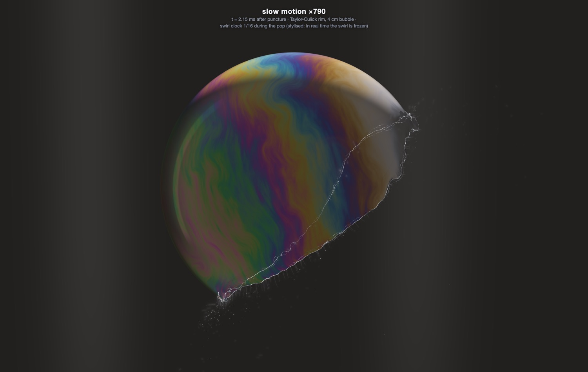

# Vortex Echo: a soap bubble that runs backwards

**A soap bubble pops, then runs backwards to where it began. Machine-checked proofs say every byte of its
simulation state comes back, for the two films the page plays and under the conditions stated below.**

[](demo/)

*The punctured bubble, drawn from the module's memory. [Open the live demo](demo/) (needs a browser with WebGL2): it
swirls, pops, runs backwards to tick 0 by itself, and then counts how many bytes differ from the start.*

Point vortices swirl over the film of a soap bubble. Then the bubble is punctured: a rim opens around the hole, the
film ripples and wobbles, and droplets fly off. Then the whole film plays **backwards**, and the bubble closes up
again.

Does it come back exactly, or only nearly? In your browser, the demo answers with a test: back at tick 0 it compares
the 1.95 MB of simulation state with where it started. The proofs answer for the two call sequences the page plays,
the auto and click films: from their stated start states and within their stated bounds, and assuming the host leaves
the module's memory alone, every byte of that state comes back. Two working areas outside it, a 96-byte stack area
and a scratch area, are left free: they may end with any values, and in the recorded test runs they did change.
([What is assumed](#what-is-assumed-or-left-out))

How can a simulation come back exactly? The module was designed to be reversible. The vortices and the rim and ring
arrays move by exactly invertible pairs of 32-bit integer updates, for example a "Fredkin leapfrog":

```
forward:  (a, b) <- (b, a + f(b))
back:     (a, b) <- (b - f(a), a)
```

The backward step needs `f` only of a value it still has, so it undoes whatever `f` computes, however messy. Each
droplet is logged with the tick it was born on, so a backward tick can take back exactly the droplets that tick made.
The puncture is different: it builds a speed table in floating point, and stepping back over the puncture tick clears
that table and the other puncture data again. The proofs check that the shipped bytes behave this way, on the start
states and domains they state.

The proofs are in [HOL Light](https://github.com/jrh13/hol-light), a proof assistant with a small trusted kernel. They
use a HOL Light model of WebAssembly from the hol-hearth project, and they are about the exact bytes of one module,
[`vortex_a1.wasm`](module/vortex_a1.wasm) (30,548 bytes, no imports), not about the C source it was compiled from.
Nothing here is proved about the picture: the film colours come from tracers on the GPU, and they are drawing only.

**[Watch it run](demo/)** · [The theorem](#the-theorem) · [What is proved, exactly](#what-is-proved-exactly) ·
[Results](#results) · [Proof trail](trail/) · [What is assumed](#what-is-assumed-or-left-out) ·
[Check it yourself](#check-it-yourself) · [Status](#status)

## The theorem

Here is the theorem about the auto film, the page's default film, exactly as it was proved. It is copied from its
frozen spec, the file that fixed its statement before the official proving run
([`c8f.spec`](proof-tree/tasks/bubble-echo/vortex/proofs/c8f.spec), lines
100 to 112). `tools/check_trail.py`
checks that this copy is that text, and that each piece of it quoted in the reading below is in it.

<!-- theorem proof-tree/tasks/bubble-echo/vortex/proofs/c8f.spec 100-112 VA1_FILM_AUTO_N -->
```
theorem VA1_FILM_AUTO_N
 `!(fs:num->byte list#num#num) (gl:num->wval) (mdl:num->int32) (N:num)
   (x0:(num->int32)#(num->int32)) (K:num) (n:num) (m0:int64->byte).
     va1_fs_np fs /\ va1_fs_pop fs /\ fs 26 = (va1_f26_mc,0,1) /\ fs 33 = (va1_puncture_mc,3,1) /\
     fs 25 = (va1_f25_mc,3,1) /\ fs 32 = (va1_f32_mc,2,1) /\ fs 34 = (va1_f34_mc,3,0) /\ gl 0 = I32 (word 16384) /\
     mdl 1 = word N /\ 1 <= N /\ N <= 640 /\ 1 <= K /\ K + 520 < 4294967296 /\ n <= 520 /\
     va1_np_st (word 0) (word K) mdl N x0 m0 /\ va1_clean m0 /\
     ~(read (bytes32 (word 16516)) m0 = word 0 /\ read (bytes32 (word 16520)) m0 = word 0 /\
       read (bytes32 (word 16524)) m0 = word 0)
     ==> va1_hrun (wasmn fs) (REPLICATE (K + n) T)
           (\gl1 m1. gl1 = gl /\ va1_snap m1 = ITER (K + n) va1_fwd (va1_snap m0) /\
              va1_hrun (wasmn fs) (REPLICATE (n + K) F)
                (\gl3 m3. gl3 = gl /\ va1_film_bytes_s m0 m3) gl1 m1) gl m0`;;
```

Read clause by clause:

<!-- clauses VA1_FILM_AUTO_N -->
- `!(fs:num->byte list#num#num) … (m0:int64->byte).` For every call table `fs`, globals `gl`, model words `mdl`,
  vortex count `N`, vortex words `x0`, puncture tick `K`, count `n` and start memory `m0`:
- `va1_fs_np fs /\ va1_fs_pop fs /\ fs 26 = (va1_f26_mc,0,1) /\ … /\ fs 34 = (va1_f34_mc,3,0)`: the call table
  holds the module's own functions. Each `va1_f…_mc` is the exact bytes of one function body of the module.
- `gl 0 = I32 (word 16384)`: global 0 starts at 16384.
- `mdl 1 = word N /\ 1 <= N /\ N <= 640`: 1 to 640 vortices.
- `1 <= K /\ K + 520 < 4294967296`: the automatic puncture is set for tick K, at least 1, and the end of the pop,
  K + 520, fits the 32-bit clock.
- `n <= 520`: the film goes n ticks past the puncture tick, at most the 520 ticks of the pop.
- `va1_np_st (word 0) (word K) mdl N x0 m0`: the start memory has clock 0, no puncture pending, the automatic
  puncture set for tick K, the model words `mdl`, and the vortex words in use equal to `x0`.
- `va1_clean m0`: a clean puncture area.
- `~(read (bytes32 (word 16516)) m0 = word 0 /\ … = word 0)`: the direction of the automatic puncture (the words at
  16516, 16520 and 16524) is not all zero.
- `va1_hrun (wasmn fs) (REPLICATE (K + n) T)`: then K + n calls of `tick_forward` (`T` is forward), in the model's
  nested-call semantics `wasmn`, each finish and return 1 with the memory still 4 MiB; the K-th does the automatic
  puncture.
- `gl1 = gl /\ va1_snap m1 = ITER (K + n) va1_fwd (va1_snap m0)`: after them the globals are as at the start, and
  the snapshot (`va1_snap`: the simulation state, the 487,424 32-bit words at bytes [16384, 1966080)) is `va1_fwd`,
  the one-tick function of [What is proved, exactly](#what-is-proved-exactly), applied K + n times to the start
  snapshot.
- `va1_hrun (wasmn fs) (REPLICATE (n + K) F)`: then n + K calls of `tick_backward` (`F` is backward) each finish
  and return 1;
- `gl3 = gl /\ va1_film_bytes_s m0 m3`: after them the globals are as at the start, and the memory is back in the
  sense of `va1_film_bytes_s`:

<!-- definition proof-tree/tasks/bubble-echo/vortex/proofs/c8f.spec 266-269 va1_film_bytes_s -->
```
definition va1_film_bytes_s
 `va1_film_bytes_s (m0:int64->byte) (m:int64->byte) <=>
    !a. a < 4194304 /\ ~(16288 <= a /\ a < 16384) /\ ~(1966080 <= a /\ a < 2039808)
        ==> read (bytes8 (word a)) m = read (bytes8 (word a)) m0`;;
```

<!-- clauses va1_film_bytes_s -->
- `!a. a < 4194304`: every byte address of the 4 MiB memory,
- `~(16288 <= a /\ a < 16384)`: except the 96-byte stack area [16288, 16384)
- `~(1966080 <= a /\ a < 2039808)`: and the scratch area [1966080, 2039808),
- `read (bytes8 (word a)) m = read (bytes8 (word a)) m0`: holds the byte it held at the start.

In words: from a start that meets the premises, run the film forward K + n ticks and then back as many, and every
byte of the 4 MiB memory is back, except the two working areas. The simulation state, bytes [16384, 1966080), lies wholly inside what comes back.
The click film ([`VA1_FILM_CLICK_N`](trail/C8f-click.html#VA1_FILM_CLICK_N)) has the same conclusion, with a
`puncture` call in the middle.

### How a result is recorded

Each result is backed by these records. The words are used in the rest of this page:

- **spec**: a file that fixes each theorem's exact statement and the definitions it uses. Each spec was reviewed
  and frozen, with its hash recorded, before the spec-locked official run that produced its receipt ([freeze records](https://github.com/BenKnill/vortex-echo/tree/main/proof-tree/tasks/bubble-echo/vortex/chain-nov/frozen)).
  The freeze fixes what that run is checked against; it does not mean no proof was tried before it. Proof
  development can run without a spec lock: C8f's headline theorems had already passed in such a run (its stage run,
  2026-11-16 00:10 EST) before its spec was frozen (13:48 EST the same day).
- **receipt**: Hearth's record of the official proving run. It shows every theorem matched the frozen spec and 0 new
  axioms were added. What is published here is the `hearth attest` summary of each receipt (`.attest.json`) and its
  `inspect` listing.
- **check-rung**: an independent check of the receipt, the spec lock, the freeze record and planted mutants
  (C3a onward; C1 and C2 came before the tool).
- **cold replay**: Hearth's cold check, which re-runs the receipt's proofs in a fresh context against the frozen
  spec.
- **class sentence**: the reviewed wording of what a result proves and what it does not cover, one per result. It is
  a summary; the theorem statements in the frozen spec are the authority.

**Follow any result to its bytes.** Each theorem has a [proof trail](trail/) that goes from its sentence on this page
to its exact statement, the line of the proof file that proves it, the receipt entry that recorded it as proved, the
cold replay, and the functions of `vortex_a1.wasm` it is about, with their byte ranges and a hex view. The auto film's
trail starts at [`VA1_FILM_AUTO_N`](trail/C8f-auto.html#VA1_FILM_AUTO_N). The shortest walk is
[part 1 of C5](trail/C5.html), whose proof you can also [re-run on your own machine](trail/C5.html#rerun).

## The demo

[`demo/`](demo/) is the page, served as static files. On load it checks that the module's SHA-256
(`a3cf8c821534dd1613e2c6c6251a003320c40d5eb2dfc8e16a871c59636aede6`) is that of the published module the proof
evidence is tied to; on a mismatch nothing runs. The page calls the module's exports (`init`, `tick_forward`,
`tick_backward`, `puncture`) and reads its
memory, to draw and for the check below. The default film swirls for 120 ticks, punctures the bubble by itself (the
"auto" puncture), lets the pop run to tick 640, then plays it backwards to tick 0 and compares the module snapshot
with where it started. At the end of the pop (520 ticks after the puncture) the page stops going forward without
calling the module again. You can also click the bubble to puncture it yourself (the "click" film).

The **verify reversal** button runs forward from the current tick (up to 1,200 ticks, toward the end of the pop),
runs back the same number of ticks, and then compares the module snapshot (bytes [16384, 1966080) of its memory,
defined below) and, separately, the active GPU tracer buffer with where they started. It reports the two counts of
differing bytes separately: the module snapshot is what the proofs are about, while the tracers are drawing state, a
browser measurement about which nothing is proved. The stack and scratch areas are not compared. That check is a
test in your browser, not a proof.

<details>
<summary>More about the controls</summary>

At the end of the pop the page cannot go forward, so the verify button reports "no ticks tested" instead of a result;
reverse some way first. While a check or a reset runs, it alone moves the simulation and both buttons are disabled.
Up to 64 other commands can wait and take effect in order, starting on the frame after the job finishes. A film takes
one puncture: a click (or pop request) on a bubble that is already punctured, or while a puncture is already waiting
for tick 1, is refused with a message; rewind to before the puncture, or reset, to puncture elsewhere. If the queue is
full, the demo shows when it refuses a control input so you can try again. The last Verify result stays on screen
through playback until another Verify or Reset starts. A check that does not come back to its starting tick reports
no verdict. If a GPU tracer read fails (for example after the browser loses the WebGL context), the check shows "GPU
tracer comparison unavailable" instead of a tracer count.

For capture tools, `PROTO.goTo(tick)` resolves with the reached state after drawing it and synchronizing WebGL.
`PROTO.timing()` reads and clears timing counters, and `PROTO.light(mode)` is a synchronous drawing control.
`PROTO.light()` without an argument reads the current mode.

</details>

## What is proved, exactly

**Plain version.** Think of the simulation's state as one 1.95 MB block of the module's memory: the clock, the
puncture data, the vortices, the rim and ring arrays, the droplet log and the speed table. **One tick:** on the states
the proofs allow, `tick_forward` turns that block into a new block that depends on the old block and nothing else,
and `tick_backward` turns it back, word for word. (`tick_backward` is only claimed on blocks that `tick_forward`
produced; at the end of the pop, where `tick_forward` returns 0 and changes nothing, there is no inverse claim.)
**The films:** for the auto film and the click film the page plays, from the stated start states and within the
stated bounds, going forward and then back the same number of ticks returns every byte of the 4 MiB memory to where it
started, except a 96-byte stack area and a scratch area that the theorems leave free.

Precisely: call the module's simulation state the **module snapshot** (the **snapshot** for short): the 487,424
32-bit words at bytes [16384, 1966080) of its 4 MiB memory (clock, puncture data, vortices, rim and ring arrays,
droplet log and speed table). The end result has two parts, [C8e](#results) for one tick and [C8f](#results) for the
films. Open each part for its exact scope.

<details>
<summary>1. One tick (C8e): the exact domain, branch by branch, and the float parameter PT</summary>

Take any snapshot in a stated domain, with the module's own functions in its call table and global 0 = 16384. The
domain asks for 1 to 640 vortices, and the rest depends on which branch the next tick takes. A plain tick (no puncture
pending and no automatic puncture due) needs a clock below 0xffffffff. The tick that does the automatic puncture
needs a clean puncture area, a direction that is not all zero and a clock below 0xfffffffe. After a puncture at tick
P, a clock before P is excluded, and the branch is decided by comparing the clock T, unsigned, with P + 520 computed
as a 32-bit word: a pop tick (T below it) needs a well-formed droplet log, and the end state (T at or above it) needs
nothing more. When P + 520 < 2^32 this means the familiar reading: pop ticks are the 520 ticks after the puncture
tick, and the end state comes after them. (If P + 520 wraps, the state counts as the end state at once.) On such a
snapshot, one call of `tick_forward` leaves a snapshot that is a fixed function of the old snapshot alone, named
`va1_fwd` in the proofs. Nothing else in memory influences it. This covers plain swirl ticks, pop ticks (with the
droplets that are born given by an explicit formula) and the tick on which the automatic puncture happens. At the end
state, `tick_forward` returns 0 and leaves the snapshot and the globals as they were
([`VA1_FWD_FUNCTION`](trail/C8e.html#VA1_FWD_FUNCTION), which speaks only about the snapshot and globals; where the
C8e class sentence says "nothing changes", this is what is proved). That the whole memory is left as it was is a
separate theorem of rung C2, [`VA1_POP_HCALL_END`](trail/C2.html#VA1_POP_HCALL_END), under its own premises (among
them: a puncture tick P is set, P <= T, and P + 520 computed as a 32-bit word is <= T) and in C2's model of calls
(wasmc); the end calls inside the films below carry the same whole-memory statement.

`tick_backward` inverts those steps, within a narrower scope. The proofs leave the puncture's float computation of the
speed table as a parameter PT; `va1_fwdt PT` is the forward step for that choice, and the shipped `va1_fwd` is one
instance. For every PT: on each snapshot that `va1_fwdt PT` produces from a domain snapshot other than the end state,
one call of `tick_backward` returns 1 and leaves `va1_bwd` of the snapshot. On the domain minus the end state,
`va1_bwd` undoes `va1_fwdt PT` word for word, and `va1_fwdt PT` is one-to-one. C8e claims nothing for `tick_backward`
on other snapshots, and the end call that returns 0 has no inverse claim. The click film below covers its complete
call sequence, backward calls included. When n = 0 there, the backward call made right after the click starts from
the clicked snapshot, which is not in these images.

</details>

<details>
<summary>2. The films (C8f): pop window, auto film, click film and click pair, call by call</summary>

The three ways the page plays the bubble are proved as whole sequences of calls to `tick_forward`, `tick_backward`
and `puncture`. Along the way the theorems name selected snapshots: as `va1_fwd` steps from a named point or, in the
click film, through the click step `va1_clk`. The list below says which. (This follows the corrected wording of the
C8f class sentence; see [Status](#status).)

- **pop window**: start from a pop-tick snapshot in the C8e domain (a puncture has happened and the clock is within
  its 520 pop ticks), with the whole walk inside the pop (P + 520 < 2^32 and T + K <= P + 520). Take any sequence of
  `tick_forward` and `tick_backward` calls whose planned clock offset from the start, counting each forward call as +1
  and each backward call as -1, stays in [0, K]. Then every call returns 1, and the sequence ends in `va1_fwd` iterated
  e times on the start, where e is the final planned offset. So the end snapshot depends only on the start and that
  offset, not on the path, and the same holds after each call of such a sequence. So for k <= K, k forward calls
  followed by k backward calls restore the whole snapshot: the droplets that were born, the rings, and the vortex
  slots the model does not use. A third theorem starts at the first pop tick (T = P): 520 forward calls, one more that
  returns 0 and changes nothing (it leaves the whole memory as it was), then 520 backward calls restore the snapshot.
  Apart from that return-0 call, these theorems say nothing about bytes outside the snapshot. Rung C2, under its own
  premises, proves a separate byte frame for its pop-window walks (`va1_pop_frame`, in
  [`VA1_POP_SCRUB_FRAME`](trail/C2.html#VA1_POP_SCRUB_FRAME) and
  [`VA1_POP_CHAIN_BYTES`](trail/C2.html#VA1_POP_CHAIN_BYTES)): every byte of the 4 MiB memory is unchanged except the
  clock word [16392, 16396), the droplet-count word [16400, 16404) and the range [1114112, 2039808). That range runs
  past the end of the snapshot (1966080), so C2's frame does not cover the scratch area [1966080, 2039808) either.
- **auto film** (the page's default): start at tick 0 with no puncture pending, a clean puncture area, 1 to 640
  vortices, the automatic puncture set for tick K (1 <= K and K + 520 < 2^32) with a direction that is not all zero,
  global 0 = 16384 and the module's own functions in the call table. Then, for n <= 520, K + n forward calls (the K-th
  does the automatic puncture) followed by n + K backward calls bring every byte of the 4 MiB memory back to its start
  value, except a 96-byte stack area [16288, 16384) and a scratch area [1966080, 2039808) that the theorem leaves free.
  The snapshot after the K + n forward calls is named as `va1_fwd` iterated K + n times on the start (taking smaller n,
  this names the snapshot after each forward call from the K-th on). The snapshots before the K-th forward call and
  during the backward run are not named; for them only the end result is stated. The same holds for the film run to
  the end of the pop and all the way back (n = 520), with one extra `tick_forward` call at the end tick that returns 0
  and leaves the whole memory as it was
  ([`VA1_FILM_AUTO_TO_END_N`](trail/C8f-auto.html#VA1_FILM_AUTO_TO_END_N)). The page never makes that extra call: it
  stops at the end tick before calling the module, so what it runs is the film without it
  ([`VA1_FILM_AUTO_N`](trail/C8f-auto.html#VA1_FILM_AUTO_N) with n = 520).
- **click film**: the same kind of start and bounds, except that the automatic puncture is off or set for a tick after
  K. Make K forward calls, then a `puncture` call whose direction is not all zero (it returns 0), then n forward calls
  (n <= 520) and n + K backward calls. The end result is the same as for the auto film. Three snapshots are named:
  after the K forward calls (`va1_fwd` iterated K times on the start); after the puncture (`va1_clk` of that snapshot:
  the click step, which sets the puncture tick to the current clock, with no swirl tick); and after the n forward calls
  (`va1_fwd` iterated n times on the clicked snapshot). Taking smaller K or n names the earlier forward points too. The
  snapshots during the backward run are not named. As for the auto film, a second theorem
  ([`VA1_FILM_CLICK_TO_END_N`](trail/C8f-click.html#VA1_FILM_CLICK_TO_END_N)) runs to the end of the pop with one
  extra `tick_forward` call that returns 0 and leaves the whole memory as it was, a call the page does not make.
- **click pair**: separately, an equation between snapshot functions (not a theorem about host calls): for a clean
  snapshot in the domain on the plain branch (no puncture pending and no automatic puncture due on the next tick),
  whose clock after the forward step is not 0xffffffff, `va1_bwd` undoes "one forward step, then the click step
  `va1_clk`". As host calls, that pair and its undo are covered only inside the click film.

For every allowed K and n, inputs meeting the film premises exist, and so does a pop-window start
([`VA1_C8F_SAT`](trail/C8f-auto.html#VA1_C8F_SAT)).

</details>

Earlier steps of the chain ([C1 to C8p](#all-results)) prove the pieces these rest on: each tick, the puncture
routine, the droplet births and the speed table.

## Results

One table, 23 results: the five main ones first, then the 18 results they rest on. Each row's name opens its
proof trail page, where every theorem of the row is shown with its exact statement. The label in the table is a short
summary that gives the main premises. The class sentence says more, and the frozen theorem statement is exact and is
the authority over both. For C8f and C8b the class sentence link goes to the corrected version (r2; see
[Status](#status)).

| result | what is proved | theorems | evidence |
|---|---|---|---|
| film: [C8f-auto](trail/C8f-auto.html) | Auto film (the page default), from tick 0 with no puncture pending, a clean puncture area and 1 <= N <= 640, with the automatic puncture set for tick K (1 <= K, K + 520 < 2^32, direction not all zero): K + n forward calls (n <= 520), then n + K back, restore every byte but two named areas; snapshot named after the forward calls from the K-th on, not before them or during the backward run | [`VA1_FILM_AUTO_N`](trail/C8f-auto.html#VA1_FILM_AUTO_N)<br>[`VA1_FILM_AUTO_TO_END_N`](trail/C8f-auto.html#VA1_FILM_AUTO_TO_END_N) | spec [`c8f.spec`](proof-tree/tasks/bubble-echo/vortex/proofs/c8f.spec)<br>receipt [c8f_final](proof-tree/tasks/bubble-echo/vortex/chain-nov/evidence/receipts/c8f_final.attest.json), check-rung PASS, cold replay [reproduced](proof-tree/tasks/bubble-echo/vortex/chain-nov/evidence/receipts/c8f_final.cold.json)<br>class sentence [r2, corrected](proof-tree/tasks/bubble-echo/vortex/chain-nov/class/C8f-r2.txt) ([r1 as reviewed](proof-tree/tasks/bubble-echo/vortex/chain-nov/class/C8f.txt)) |
| film: [C8f-click](trail/C8f-click.html) | Click film, from tick 0 with no puncture pending, a clean puncture area and 1 <= N <= 640, with the automatic puncture off or after tick K (1 <= K, K + 520 < 2^32): K forward calls, a puncture call with a direction not all zero (returns 0), n <= 520 forward, then n + K back, restore every byte but the same two areas; snapshots named after the K forward calls, after the puncture (the click step va1_clk) and after the n forward calls, not during the backward run | [`VA1_FILM_CLICK_N`](trail/C8f-click.html#VA1_FILM_CLICK_N)<br>[`VA1_FILM_CLICK_TO_END_N`](trail/C8f-click.html#VA1_FILM_CLICK_TO_END_N) | spec [`c8f.spec`](proof-tree/tasks/bubble-echo/vortex/proofs/c8f.spec)<br>receipt [c8f_final](proof-tree/tasks/bubble-echo/vortex/chain-nov/evidence/receipts/c8f_final.attest.json), check-rung PASS, cold replay [reproduced](proof-tree/tasks/bubble-echo/vortex/chain-nov/evidence/receipts/c8f_final.cold.json)<br>class sentence [r2, corrected](proof-tree/tasks/bubble-echo/vortex/chain-nov/class/C8f-r2.txt) ([r1 as reviewed](proof-tree/tasks/bubble-echo/vortex/chain-nov/class/C8f.txt)) |
| film: [C8f-pop](trail/C8f-pop.html) | Pop window, with the module's functions in place, from a pop-tick domain snapshot with the walk inside the pop: for any sequence of forward and backward tick calls whose planned clock offset (+1 forward, -1 back) stays in [0, K], every call returns 1 and the snapshot depends only on the start and the final offset; k <= K forward then k back restores the snapshot; from T = P, 520 forward calls to the end, one more forward call that returns 0 and changes neither globals nor memory, and 520 back to the start | [`VA1_POP_SCRUB_N`](trail/C8f-pop.html#VA1_POP_SCRUB_N)<br>[`VA1_POP_CHAIN_N`](trail/C8f-pop.html#VA1_POP_CHAIN_N)<br>[`VA1_POP_CHAIN_TO_END_N`](trail/C8f-pop.html#VA1_POP_CHAIN_TO_END_N) | spec [`c8f.spec`](proof-tree/tasks/bubble-echo/vortex/proofs/c8f.spec)<br>receipt [c8f_final](proof-tree/tasks/bubble-echo/vortex/chain-nov/evidence/receipts/c8f_final.attest.json), check-rung PASS, cold replay [reproduced](proof-tree/tasks/bubble-echo/vortex/chain-nov/evidence/receipts/c8f_final.cold.json)<br>class sentence [r2, corrected](proof-tree/tasks/bubble-echo/vortex/chain-nov/class/C8f-r2.txt) ([r1 as reviewed](proof-tree/tasks/bubble-echo/vortex/chain-nov/class/C8f.txt)) |
| one tick: [C8e](trail/C8e.html) | On the stated domain (conditions by branch), tick_forward is a function va1_fwd of the snapshot (the end call returns 0 and leaves the snapshot and globals as they were; whole memory: C2's VA1_POP_HCALL_END). For any table parameter PT, on the snapshots va1_fwdt PT produces off the end state, tick_backward is the function va1_bwd, which undoes va1_fwdt PT; C8e claims nothing for tick_backward on other snapshots | [`VA1_FWD_FUNCTION`](trail/C8e.html#VA1_FWD_FUNCTION)<br>[`VA1_BWD_FUNCTION`](trail/C8e.html#VA1_BWD_FUNCTION)<br>[`VA1_BWD_FWD`](trail/C8e.html#VA1_BWD_FWD)<br>[`VA1_FWD_INJ`](trail/C8e.html#VA1_FWD_INJ) | spec [`c8e_defs.spec`](proof-tree/tasks/bubble-echo/vortex/proofs/c8e_defs.spec)<br>spec [`c8e.spec`](proof-tree/tasks/bubble-echo/vortex/proofs/c8e.spec)<br>receipt [c8e_defs_probe](proof-tree/tasks/bubble-echo/vortex/chain-nov/evidence/receipts/c8e_defs_probe.attest.json), check-rung PASS, cold replay [reproduced](proof-tree/tasks/bubble-echo/vortex/chain-nov/evidence/receipts/c8e_defs_probe.cold.json)<br>receipt [c8e_final](proof-tree/tasks/bubble-echo/vortex/chain-nov/evidence/receipts/c8e_final.attest.json), check-rung PASS, cold replay [reproduced](proof-tree/tasks/bubble-echo/vortex/chain-nov/evidence/receipts/c8e_final.cold.json)<br>class sentence [C8e.txt](proof-tree/tasks/bubble-echo/vortex/chain-nov/class/C8e.txt) |
| one tick: [C8f-pair](trail/C8f-pair.html) | An equation between snapshot functions, not a host-call theorem: for a clean domain snapshot on the plain branch (no puncture pending or due; clock after the step not 0xffffffff), va1_bwd undoes "va1_fwd, then the click step va1_clk" | [`VA1_CLICK_PAIR_INV`](trail/C8f-pair.html#VA1_CLICK_PAIR_INV) | spec [`c8f.spec`](proof-tree/tasks/bubble-echo/vortex/proofs/c8f.spec)<br>receipt [c8f_final](proof-tree/tasks/bubble-echo/vortex/chain-nov/evidence/receipts/c8f_final.attest.json), check-rung PASS, cold replay [reproduced](proof-tree/tasks/bubble-echo/vortex/chain-nov/evidence/receipts/c8f_final.cold.json)<br>class sentence [r2, corrected](proof-tree/tasks/bubble-echo/vortex/chain-nov/class/C8f-r2.txt) ([r1 as reviewed](proof-tree/tasks/bubble-echo/vortex/chain-nov/class/C8f.txt)) |

<details id="all-results">
<summary>The 18 results the main ones rest on, C1 to C8p (the full chain)</summary>

| result | what is proved | theorems | evidence |
|---|---|---|---|
| film: [C1](trail/C1.html) | no-pop round trip from clock 0 (no pop pending, auto-pop word 0, 1 <= N <= 640): for any n < 2^32, n forward then n backward tick calls restore the clock, pop words, model and the 3N vortex words in use; every other byte unchanged except the scratch area and the unused vortex words (not pinned) | [27 theorems](trail/C1.html#theorems) | spec [`chain_c1_final.spec`](proof-tree/tasks/bubble-echo/vortex/proofs/chain_c1_final.spec)<br>receipt [chain_c1_final](proof-tree/tasks/bubble-echo/vortex/chain-nov/evidence/receipts/chain_c1_final.attest.json), check-rung -, cold replay [reproduced](proof-tree/tasks/bubble-echo/vortex/chain-nov/evidence/receipts/chain_c1_final.cold.json)<br>class sentence [C1.txt](proof-tree/tasks/bubble-echo/vortex/chain-nov/class/C1.txt) |
| film: [C2](trail/C2.html) | v1 pop window, from a start in the window after a puncture (p <= t0, p + 520 < 2^32, 1 <= N <= 640, well-formed droplet log; the puncture tick itself not covered): any sequence of forward/backward tick calls whose planned clock walk (+1 per forward, -1 per backward) stays in [t0, t0 + K] (t0 + K <= p + 520) has every call return 1 and ends at clock u with the used vortex words u - t0 swirl steps of the start (births only "some list"); k forward then k backward calls (t0 + k <= p + 520) restore the clock, the vortex words in use, rings, droplets, header and speed table (scratch and unused vortex words not pinned) | [33 theorems](trail/C2.html#theorems) | spec [`chain_c2_final.spec`](proof-tree/tasks/bubble-echo/vortex/proofs/chain_c2_final.spec)<br>receipt [chain_c2_final](proof-tree/tasks/bubble-echo/vortex/chain-nov/evidence/receipts/chain_c2_final.attest.json), check-rung -, cold replay [reproduced](proof-tree/tasks/bubble-echo/vortex/chain-nov/evidence/receipts/chain_c2_final.cold.json)<br>class sentence [C2.txt](proof-tree/tasks/bubble-echo/vortex/chain-nov/class/C2.txt) |
| tick: [C3a](trail/C3a.html) | tick_backward at the pop tick (clock = pop word, pop word neither -1 nor 0, 1 <= N <= 640): adds the mismatch count to healErr (as a 32-bit word), clears the pop state, undoes the swirl tick, returns 1 | [15 theorems](trail/C3a.html#theorems) | spec [`chain_c3a_final2.spec`](proof-tree/tasks/bubble-echo/vortex/proofs/chain_c3a_final2.spec)<br>receipt [chain_c3a_final](proof-tree/tasks/bubble-echo/vortex/chain-nov/evidence/receipts/chain_c3a_final.attest.json), check-rung PASS, cold replay [reproduced](proof-tree/tasks/bubble-echo/vortex/chain-nov/evidence/receipts/chain_c3a_final.cold.json)<br>class sentence [C3a.txt](proof-tree/tasks/bubble-echo/vortex/chain-nov/class/C3a.txt) |
| routine: [C3b](trail/C3b.html) | f25 puncture seed, successful branch (no pop pending: word 16396 = -1, direction not all zero): finishes, returns 0, writes only the named regions; guards: with a pop pending it returns 1 whatever the direction; with no pop pending and an all-zero direction it returns 2 | [9 theorems](trail/C3b.html#theorems) | spec [`chain_c3b_final.spec`](proof-tree/tasks/bubble-echo/vortex/proofs/chain_c3b_final.spec)<br>receipt [chain_c3b_final](proof-tree/tasks/bubble-echo/vortex/chain-nov/evidence/receipts/chain_c3b_final.attest.json), check-rung PASS, cold replay [reproduced](proof-tree/tasks/bubble-echo/vortex/chain-nov/evidence/receipts/chain_c3b_final.cold.json)<br>class sentence [C3b.txt](proof-tree/tasks/bubble-echo/vortex/chain-nov/class/C3b.txt) |
| film: [C4](trail/C4.html) | click and auto-puncture films from tick 0 with no puncture pending, a clean puncture area and 1 <= N <= 640 (1 <= K, K + 520 < 2^32, n <= 520; auto: auto-pop word K; click: auto-pop word 0 or above K), with the puncture step modelled by a TESTED relation (not proved): the click call, or in the auto form the K-th forward call (a plain swirl tick followed by that relation, after K - 1 proved forward calls) | [23 theorems](trail/C4.html#theorems) | spec [`chain_c4_final.spec`](proof-tree/tasks/bubble-echo/vortex/proofs/chain_c4_final.spec)<br>receipt [chain_c4_final](proof-tree/tasks/bubble-echo/vortex/chain-nov/evidence/receipts/chain_c4_final.attest.json), check-rung PASS, cold replay [reproduced](proof-tree/tasks/bubble-echo/vortex/chain-nov/evidence/receipts/chain_c4_final.cold.json)<br>class sentence [C4.txt](proof-tree/tasks/bubble-echo/vortex/chain-nov/class/C4.txt) |
| routine: [C5](trail/C5.html) | puncture helpers f32/f34/f33 to f25 and the trunc guard (parts 1 and 2) | [22 theorems](trail/C5.html#theorems) | spec [`chain_c5_leaves.spec`](proof-tree/tasks/bubble-echo/vortex/proofs/chain_c5_leaves.spec)<br>spec [`chain_c5_punct.spec`](proof-tree/tasks/bubble-echo/vortex/proofs/chain_c5_punct.spec)<br>spec [`chain_c5_tof25.spec`](proof-tree/tasks/bubble-echo/vortex/proofs/chain_c5_tof25.spec)<br>receipt [chain_c5_leaves_final](proof-tree/tasks/bubble-echo/vortex/chain-nov/evidence/receipts/chain_c5_leaves_final.attest.json), check-rung PASS, cold replay [reproduced](proof-tree/tasks/bubble-echo/vortex/chain-nov/evidence/receipts/chain_c5_leaves_final.cold.json)<br>receipt [chain_c5_punct_final](proof-tree/tasks/bubble-echo/vortex/chain-nov/evidence/receipts/chain_c5_punct_final.attest.json), check-rung PASS, cold replay [reproduced](proof-tree/tasks/bubble-echo/vortex/chain-nov/evidence/receipts/chain_c5_punct_final.cold.json)<br>receipt [chain_c5_tof25_final](proof-tree/tasks/bubble-echo/vortex/chain-nov/evidence/receipts/chain_c5_tof25_final.attest.json), check-rung PASS, cold replay [reproduced](proof-tree/tasks/bubble-echo/vortex/chain-nov/evidence/receipts/chain_c5_tof25_final.cold.json)<br>class sentence [C5.txt](proof-tree/tasks/bubble-echo/vortex/chain-nov/class/C5.txt) |
| model: [C5'](trail/C5p.html) | nested call model wasmn on the chain; wasmc results carried over; puncture call rules | [31 theorems](trail/C5p.html#theorems) | spec [`chain_c5p.spec`](proof-tree/tasks/bubble-echo/vortex/proofs/chain_c5p.spec)<br>receipt [chain_c5p_final](proof-tree/tasks/bubble-echo/vortex/chain-nov/evidence/receipts/chain_c5p_final.attest.json), check-rung PASS, cold replay [reproduced](proof-tree/tasks/bubble-echo/vortex/chain-nov/evidence/receipts/chain_c5p_final.cold.json)<br>class sentence [C5p.txt](proof-tree/tasks/bubble-echo/vortex/chain-nov/class/C5p.txt) |
| routine: [C6a](trail/C6a.html) | one host call of the export puncture (click) from P = -1, nonzero clock, arguments not all zero, memory size 4194304, global 0 = 16384 and the call map sending 25, 32 and 34 to the module's own f25, f32 and f34: always finishes, returns 0, with the pop set-up and byte frame named (no float value, table entry, frame double or header word 9..29 claimed) | [4 theorems](trail/C6a.html#theorems) | spec [`chain_c6a_final.spec`](proof-tree/tasks/bubble-echo/vortex/proofs/chain_c6a_final.spec)<br>receipt [chain_c6a_final](proof-tree/tasks/bubble-echo/vortex/chain-nov/evidence/receipts/chain_c6a_final.attest.json), check-rung PASS, cold replay [reproduced](proof-tree/tasks/bubble-echo/vortex/chain-nov/evidence/receipts/chain_c6a_final.cold.json)<br>class sentence [C6a.txt](proof-tree/tasks/bubble-echo/vortex/chain-nov/class/C6a.txt) |
| tick: [C6b](trail/C6b.html) | tick_forward on the auto-pop branch (nested model), under its entry premises (P = -1, auto-pop word = T + 1 <> 0, direction words at 16516..16524 not all zero, 1 <= N <= 640, global 0 = 16384, call table): returns 1; memory = the C6a puncture relation applied to the intermediate swirl state (table values, header words 9..29 and scratch not specified) | [3 theorems](trail/C6b.html#theorems) | spec [`chain_c6b_final.spec`](proof-tree/tasks/bubble-echo/vortex/proofs/chain_c6b_final.spec)<br>receipt [chain_c6b_final](proof-tree/tasks/bubble-echo/vortex/chain-nov/evidence/receipts/chain_c6b_final.attest.json), check-rung PASS, cold replay [reproduced](proof-tree/tasks/bubble-echo/vortex/chain-nov/evidence/receipts/chain_c6b_final.cold.json)<br>class sentence [C6b.txt](proof-tree/tasks/bubble-echo/vortex/chain-nov/class/C6b.txt) |
| film: [C7b](trail/C7b.html) | the page default pop film, auto puncture, from tick 0 with no puncture pending, a clean puncture area and 1 <= N <= 640 (auto-pop word K, 1 <= K, K + 520 < 2^32, n <= 520, auto-puncture direction not all zero): back at the start except three unpinned regions (stack area, unused vortex slots, scratch) | [4 theorems](trail/C7b.html#theorems) | spec [`chain_c7b_final.spec`](proof-tree/tasks/bubble-echo/vortex/proofs/chain_c7b_final.spec)<br>receipt [chain_c7b_final](proof-tree/tasks/bubble-echo/vortex/chain-nov/evidence/receipts/chain_c7b_final.attest.json), check-rung PASS, cold replay [reproduced](proof-tree/tasks/bubble-echo/vortex/chain-nov/evidence/receipts/chain_c7b_final.cold.json)<br>class sentence [C7.txt](proof-tree/tasks/bubble-echo/vortex/chain-nov/class/C7.txt) |
| film: [C7a](trail/C7a.html) | the click pop film, from tick 0 with no puncture pending, a clean puncture area and 1 <= N <= 640 (auto-pop word 0 or above K, 1 <= K, K + 520 < 2^32, n <= 520, puncture direction not all zero): back at the start except the same three unpinned regions | [4 theorems](trail/C7a.html#theorems) | spec [`chain_c7a_final.spec`](proof-tree/tasks/bubble-echo/vortex/proofs/chain_c7a_final.spec)<br>receipt [chain_c7a_final](proof-tree/tasks/bubble-echo/vortex/chain-nov/evidence/receipts/chain_c7a_final.attest.json), check-rung PASS, cold replay [reproduced](proof-tree/tasks/bubble-echo/vortex/chain-nov/evidence/receipts/chain_c7a_final.cold.json)<br>class sentence [C7.txt](proof-tree/tasks/bubble-echo/vortex/chain-nov/class/C7.txt) |
| tick: [C8b](trail/C8b.html) | 11 named tick contracts (plain and pop ticks both ways, un-puncture, auto puncture), under their original preconditions, also preserve the unused vortex slots (gap G2); VA1_TICK_INVERSE_VK not strengthened; film forms not re-run (class sentence corrected: r2) | [29 theorems](trail/C8b.html#theorems) | spec [`c8b_final.spec`](proof-tree/tasks/bubble-echo/vortex/proofs/c8b_final.spec)<br>receipt [c8b_final](proof-tree/tasks/bubble-echo/vortex/chain-nov/evidence/receipts/c8b_final.attest.json), check-rung PASS, cold replay [reproduced](proof-tree/tasks/bubble-echo/vortex/chain-nov/evidence/receipts/c8b_final.cold.json)<br>class sentence [r2, corrected](proof-tree/tasks/bubble-echo/vortex/chain-nov/class/C8b-r2.txt) ([r1 as reviewed](proof-tree/tasks/bubble-echo/vortex/chain-nov/class/C8b.txt)) |
| routine: [C8a-births](trail/C8a-births.html) | droplet birth f13, from VA1_BIRTH_EQ's precondition, appends a named list of records (VA1_BIRTH_EQ; born probe) | [25 theorems](trail/C8a-births.html#theorems) | spec [`c8a_born.spec`](proof-tree/tasks/bubble-echo/vortex/proofs/c8a_born.spec)<br>spec [`c8a_birth.spec`](proof-tree/tasks/bubble-echo/vortex/proofs/c8a_birth.spec)<br>receipt [c8a_born_probe](proof-tree/tasks/bubble-echo/vortex/chain-nov/evidence/receipts/c8a_born_probe.attest.json), check-rung PASS, cold replay [reproduced](proof-tree/tasks/bubble-echo/vortex/chain-nov/evidence/receipts/c8a_born_probe.cold.json)<br>receipt [c8a_birth_final](proof-tree/tasks/bubble-echo/vortex/chain-nov/evidence/receipts/c8a_birth_final.attest.json), check-rung PASS, cold replay [reproduced](proof-tree/tasks/bubble-echo/vortex/chain-nov/evidence/receipts/c8a_birth_final.cold.json)<br>class sentence [C8a-births.txt](proof-tree/tasks/bubble-echo/vortex/chain-nov/class/C8a-births.txt) |
| tick: [C8a-tick](trail/C8a-tick.html) | pop-window forward tick, under the entry conditions of VA1_TICK_FORWARD_POP_R5C_U, with the births named (A8/A9, VA1_TICK_FORWARD_POP_R5C_NU) | [13 theorems](trail/C8a-tick.html#theorems) | spec [`c8a_r4n.spec`](proof-tree/tasks/bubble-echo/vortex/proofs/c8a_r4n.spec)<br>receipt [c8a_r4n](proof-tree/tasks/bubble-echo/vortex/chain-nov/evidence/receipts/c8a_r4n.attest.json), check-rung PASS, cold replay [reproduced](proof-tree/tasks/bubble-echo/vortex/chain-nov/evidence/receipts/c8a_r4n.cold.json)<br>class sentence [C8a-tick.txt](proof-tree/tasks/bubble-echo/vortex/chain-nov/class/C8a-tick.txt) |
| routine: [C8p-P12](trail/C8p-P12.html) | under the entry conditions of VA1_F32_VALUE and VA1_F34_VALUE (f34 called as f34(16352, 16320, 16288) with a 4194304-byte memory): f32 returns a named term; f34 stores six f64 words that are named terms (float rounding unspecified; sin/cos routine of the puncture) | [3 theorems](trail/C8p-P12.html#theorems) | spec [`c8p_leaves2.spec`](proof-tree/tasks/bubble-echo/vortex/proofs/c8p_leaves2.spec)<br>receipt [c8p_leaves2_final](proof-tree/tasks/bubble-echo/vortex/chain-nov/evidence/receipts/c8p_leaves2_final.attest.json), check-rung PASS, cold replay [reproduced](proof-tree/tasks/bubble-echo/vortex/chain-nov/evidence/receipts/c8p_leaves2_final.cold.json)<br>class sentence [C8p-P12.txt](proof-tree/tasks/bubble-echo/vortex/chain-nov/class/C8p-P12.txt) |
| routine: [C8p-P34](trail/C8p-P34.html) | f33, under VA1_F33_TO_F25's entry conditions, reaches its call 25 with the speed table named | [1 theorems](trail/C8p-P34.html#theorems) | spec [`c8p_f33.spec`](proof-tree/tasks/bubble-echo/vortex/proofs/c8p_f33.spec)<br>receipt [c8p_f33_final](proof-tree/tasks/bubble-echo/vortex/chain-nov/evidence/receipts/c8p_f33_final.attest.json), check-rung PASS, cold replay [reproduced](proof-tree/tasks/bubble-echo/vortex/chain-nov/evidence/receipts/c8p_f33_final.cold.json)<br>class sentence [C8p-P34.txt](proof-tree/tasks/bubble-echo/vortex/chain-nov/class/C8p-P34.txt) |
| routine: [C8p-P5](trail/C8p-P5.html) | f25, under VA1_F25_OK's entry conditions, also writes the named header words 9..29 | [1 theorems](trail/C8p-P5.html#theorems) | spec [`c8p_f25h2.spec`](proof-tree/tasks/bubble-echo/vortex/proofs/c8p_f25h2.spec)<br>receipt [c8p_f25h2_final](proof-tree/tasks/bubble-echo/vortex/chain-nov/evidence/receipts/c8p_f25h2_final.attest.json), check-rung PASS, cold replay [reproduced](proof-tree/tasks/bubble-echo/vortex/chain-nov/evidence/receipts/c8p_f25h2_final.cold.json)<br>class sentence [C8p-P5.txt](proof-tree/tasks/bubble-echo/vortex/chain-nov/class/C8p-P5.txt) |
| tick: [C8p-P67](trail/C8p-P67.html) | auto puncture tick and click puncture, under the premises of the theorems they extend, with the named speed table and header | [3 theorems](trail/C8p-P67.html#theorems) | spec [`c8p_nu.spec`](proof-tree/tasks/bubble-echo/vortex/proofs/c8p_nu.spec)<br>receipt [c8p_nu_final](proof-tree/tasks/bubble-echo/vortex/chain-nov/evidence/receipts/c8p_nu_final.attest.json), check-rung PASS, cold replay [reproduced](proof-tree/tasks/bubble-echo/vortex/chain-nov/evidence/receipts/c8p_nu_final.cold.json)<br>class sentence [C8p-P67.txt](proof-tree/tasks/bubble-echo/vortex/chain-nov/class/C8p-P67.txt) |

</details>

## What is assumed or left out

These limits come from the class sentences (two of them corrected; see [Status](#status)). They are part of the
result, not footnotes.

- **The host keeps out.** Every call is modelled with the assumption that nothing else writes the module's
  memory or globals between or during calls, and that memory does not grow. This is an assumption about the host
  running the module, not something proved here.
- **`init` is tested, not proved.** The theorems start from states of a stated shape. That `init(seed, ...)` leaves
  such a state was tested on the real bytes (8 seeds for C1; 24 header checks with 24 planted mutants, plus a matrix
  of films, for C4 and C7), but it is not proved.
- **Floating point stays opaque.** The puncture builds its speed table in 64-bit floating point. The model fixes
  the float rounding operations as functions but does not say what they compute, and every theorem holds for any
  choice of them. So the table appears in the proofs as a named term (`va1_ptbl`) and no float value is claimed.
  Comparisons and trapping conversions are exact on the bits.
- **States outside the domain.** C8e and the C8f films make no claim for: vortex counts outside 1 to 640; a clock
  before the puncture tick; clock wraparound on a plain tick; a pop tick with a malformed droplet log; an automatic
  puncture at the last clock value, or from an unclean puncture area or an all-zero direction; film starts that do
  not meet their stated start conditions; `tick_backward` on snapshots outside C8e's images (other than the backward
  calls of the films); refused calls or other exports. Some earlier rows (for example C6b and C8p-P67) have their own
  premises, which cover some of these states; their class sentences say which.
- **Bytes outside the snapshot.** The one-tick result says these do not influence the snapshot, and nothing more. At
  the end of a film, the 96-byte stack area and the scratch area are left free by the theorems (in the recorded test
  runs they did change). Apart from the return-0 call at the end of the pop, which leaves the whole memory unchanged,
  the C8f pop-window theorems say nothing outside the snapshot; C2's separate frame leaves the clock and droplet-count
  words and all of [1114112, 2039808), scratch included, free.
- **The trusted base.** The HOL Light kernel; hol-hearth's model of WebAssembly, including its rule that a nested
  call runs as one step; and the premises that the call table maps each index to the module's own functions and
  that global 0 starts at 16384. That the model agrees with real WebAssembly engines is not proved.
- **Not about the picture.** Nothing is proved about the browser page, the GPU tracers or the drawing, about what the
  numbers mean physically, or about the later "v5.8" renderer. That the page makes these call sequences was read
  from its code, not proved.

## Check it yourself

**The module.** `shasum -a 256 module/vortex_a1.wasm` should print
`a3cf8c821534dd1613e2c6c6251a003320c40d5eb2dfc8e16a871c59636aede6`. This hash identifies the published module the
proof evidence is tied to: the spec files record it, and the receipts and `check_tree.py` tie the proved files to it. The
theorems themselves name the modeled calls and the definitions of the function bytes, not the hash.

**The files are the proved files.** From a checkout of this repository:

```sh
python3 -I tools/check_tree.py
```

For every receipt this checks by SHA-256 that the proof source, the frozen spec, the wasm modules and every project
file the run read (its closure inventory) are the files published here. It needs only Python's standard library and
re-runs no proof. Expected output: `24 receipts, 1607 file checks, 0 problems`.

**The proof trail shows what the files record.** The [proof trail](trail/) pages are generated from the published
files by `python3 -I tools/build_trail.py`. This checks them without the generator:

```sh
python3 -I tools/check_trail.py
```

It checks that every relative link on the front page (`index.html`) and in the trail resolves (links to websites,
GitHub included, are not followed); that every quoted statement (the one on this page included) is the text at the
stated lines of the frozen spec the receipt locks; that every proof line names its theorem and is the line the receipt
records; that every receipt entry shown is in the receipt; and that every byte range and hex view is the module's
bytes. Its output ends with `0 problems`. Like `check_tree.py`, it re-runs no proof.

**Re-running a proof yourself.** Part 1 of C5 can be re-run on Linux, with the prerequisites in the replay guide,
from public sources and the files in [`replay/`](replay/README.md): an exact copy of the WebAssembly model the proofs
load (hol-hearth's `wasm` profile at `6adb41ce`) and a small checker. With OCaml 5.4.0 and Camlp5 8.04.00 installed
(the replay guide, [`replay/README.md`](replay/README.md), lists every prerequisite and the opam commands), from the
root of a checkout:

```sh
bash replay/setup.sh ../vortex-c5-build      # once: fetches and builds HOL Light 2a1cea8f, fetches s2n-bignum 51d1db8f
python3 -I replay/c5.py ../vortex-c5-build   # the replay, a few minutes
```

It starts a fresh HOL Light, loads the model from source, runs the proof, and checks every theorem against the
frozen spec, the 24 pinned definitions, and that no axiom was added. It checks the proof inputs it re-reads from the
official run against the SHA-256 values in that run's receipt, and the files it opens from the model, HOL Light and
s2n-bignum against their pinned versions; the OCaml toolchain and system files are trusted. It should end with the
same `PASSED` line as below. [`replay/README.md`](replay/README.md) says what it checks and what it trusts.

**Re-running the other proofs.** These need a Linux host with [HOL Light](https://github.com/jrh13/hol-light) at
`2a1cea8f` and hol-hearth at the recorded revision (`6adb41ce`; `81c0fa6c` for C1 and C2) with its `wasm` profile.
hol-hearth is not public yet, so for now only its maintainers can do this step. With hol-hearth, part 1 of C5, whose
files need no overlay, runs from `proof-tree/` as:

```sh
hearth prove tasks/bubble-echo/vortex/proofs/chain_c5_leaves_final.ml --profile wasm \
  --spec tasks/bubble-echo/vortex/proofs/chain_c5_leaves.spec
```

It should end with `PASSED chain_c5_leaves_final.ml: 14/14 bindings proved, 14/14 spec bindings matched, 24/24 spec
pins matched, 0 new axioms`. For the other results, copy `tasks/bubble-echo/vortex/chain-nov/overlay/.` over the tree
first. For the layered C8 runs, see the [chain README](proof-tree/tasks/bubble-echo/vortex/chain-nov/README.md). It
was written for the project's private working repository: its step 1 (the claim generator, its tests and
`tools/vab`) uses files that are not published here, so use `tools/check_tree.py` instead. Its step 2 (the
`hearth prove` commands and `recipe/finish-c8-stages.json`) applies to `proof-tree/` as published: where it says to
make a worktree and work from it, use a copy of `proof-tree/` with the overlay copied over it, and run the commands
from that copy. Those commands are written from the run records. They have not been re-run from this repository.

## What is in this repository

| path | what |
|---|---|
| [`demo/`](demo/) | the page: `vortex_a1.wasm` plus the drawing code |
| [`module/`](https://github.com/BenKnill/vortex-echo/tree/main/module) | `vortex_a1.wasm`, its C source (`vortex.c`, `ve_core.c`), [build notes](module/BUILD.md) and `SHA256SUMS` |
| [`claims.json`](claims.json) | the claim table: one row per result, with its receipts, spec, class sentence, cold status and reviews |
| [`proof-tree/`](https://github.com/BenKnill/vortex-echo/tree/main/proof-tree) | the proof sources and specs, at the same paths as in the project's working repository |
| [`…/chain-nov/class/`](https://github.com/BenKnill/vortex-echo/tree/main/proof-tree/tasks/bubble-echo/vortex/chain-nov/class) | the reviewed class sentences, plus the corrected `C8f-r2.txt` and `C8b-r2.txt` |
| [`…/chain-nov/evidence/`](https://github.com/BenKnill/vortex-echo/tree/main/proof-tree/tasks/bubble-echo/vortex/chain-nov/evidence) | receipt attests, inspect listings, cold-replay records, check-rung outputs and closure inventories |
| [`trail/`](trail/) | the proof trail: one page per result, the proof files with line anchors, and the module's bytes with a hex view |
| [`tools/check_tree.py`](tools/check_tree.py) | the hash check above |
| [`tools/build_trail.py`](tools/build_trail.py) | writes `trail/` from the published files |
| [`tools/check_trail.py`](tools/check_trail.py) | checks `trail/` and the statement on this page, without the generator |
| [`replay/`](replay/README.md) | the standalone re-run of C5 part 1: scripts and an exact copy of hol-hearth's WebAssembly model |
| `MANIFEST.sha256` | the SHA-256 of every other file here |

Licence: see [LICENSE](LICENSE) and [NOTICE](NOTICE).

## Status

Checked on 2026-11-17:

- **Proved.** 23 claim rows from 24 official receipts. Every receipt PASSED, every theorem matched its frozen spec,
  and 0 new axioms were added. C3a onward also passed check-rung.
- **Cold-replayed: all 24 receipts.** Each was re-run in a fresh context against its frozen spec and reproduced with
  0 new axioms.
- **Corrected after publication.** A newer reviewer found wording on this page, and in two class sentences, that said
  more than the theorems. The wording was corrected on 2026-11-17. The theorems, specs, receipts, cold replays and
  module bytes did not change. Details below.
- **Who did the work.** The proofs, specs, class sentences and this page were written by AI agents (the records
  name Anthropic's Claude Opus 5.5) working for Ben Knill, and reviewed as below.

<details>
<summary>Review and correction history</summary>

- **Cold replays.** The C8f cold replay rebuilt all 24 of its basis layers from the root. The last six
  (`c8a_born_probe`, `c8a_birth_final`, `c8p_leaves2_final`, `c8p_f25h2_final`, `c8p_f33_final` and
  `c8e_defs_probe`) were cold-checked on 2026-11-17, after the snapshot of the project's private ledger this page was
  built from (VAB `a70e29d0`). That ledger still lists those six as not cold-replayed until a follow-up update;
  `claims.json` here carries the new status and a note saying so (`cold_status_note`).
- **Reviews.** GPT-6.1 Sol (an OpenAI model used as an adversarial reviewer) reviewed every spec before it was
  frozen, and each was frozen at a score of 9 or 10 out of 10. It also reviewed the C8f proof and class sentence
  (9, then 10), the import of the chain into the project's claim ledger (7, 8, then 9), and the C8f
  addition to that ledger (9, then 10). The same reviewer checked this page and its list of published files before
  publication (8, then 9, then 10).
- **Corrections (2026-11-17).** After publication, GPT-6.2 Sol, a newer version of the same reviewer, re-ran three of
  those reviews. It found wording that said more than the theorems. On this page: the scope of the inverse, the
  premises of the films, what the demo's check compares, and several table labels. In two class sentences: C8f and
  C8b. The theorems, specs, receipts and cold replays did not change. This page and the row labels in `claims.json`
  were corrected. The two class sentences are left as they were reviewed, and each has a corrected version beside it,
  with an erratum at the top: [`C8f-r2.txt`](proof-tree/tasks/bubble-echo/vortex/chain-nov/class/C8f-r2.txt) (the
  films name the snapshot at stated points, not at every intermediate step, and the click pair is an equation between
  snapshot functions, not a host-call theorem) and
  [`C8b-r2.txt`](proof-tree/tasks/bubble-echo/vortex/chain-nov/class/C8b-r2.txt) (11 named tick theorems gained the
  unused-slot statement, not every tick theorem: `VA1_TICK_INVERSE_VK` did not). The tables link the corrected
  versions. The frozen spec `c8f.spec` is unchanged, so its comment header still repeats the r1 wording; its theorem
  statements are the authority. Its test note's table check (PTCHECK) sampled 32 cells per table (4 fixed, 28
  random), and its full-snapshot comparisons used the table the module wrote. The project's private ledger (VAB
  `a70e29d0`) still has the original wording until a follow-up update.
- **Fix batch (2026-11-17, evening).** An advisory review by GPT-6.2 Astra (another OpenAI model) led to these
  changes: the spec glossary above now says when each spec was frozen relative to its runs; in `claims.json` the
  ordinary class-sentence fields of the C8f and C8b rows now give the corrected versions (the reviewed originals are
  kept as `class_sentence_as_imported` and related fields), the C8f film labels state their start conditions, and the
  C6a, C8e and C8f-pop labels name more of their premises (C8f-pop now also states the end call that returns 0)
  and the C4 label says which call the tested puncture relation models; the
  chain README's "Start here" points to this repository's `claims.json`; the demo checks the module's SHA-256 before
  instantiating it (on a mismatch nothing runs), reports "no ticks tested" at the end of the pop, counts the module
  snapshot and the GPU tracers separately and gives no tracer count when a tracer read fails, and its status line
  now sits above the control row. No theorem, spec, receipt or module byte changed. GPT-6.2 Sol reviewed that
  fix batch and the list of published files before publication. A later controller update addressed Astra's finding
  B.3 about controls disturbing a check (see [The demo](#the-demo)).

</details>

The proofs ran on hol-hearth `6adb41ce` (C1 and C2 on `81c0fa6c`), HOL Light `2a1cea8f`, profile
`hol.s2n.wasm.v1`. Host paths inside the receipt files (`/home/bluestar/...`) record where each run happened. They
are not inputs.

---

**[Watch it again](demo/)**: the bubble swirls and pops, runs 640 ticks out and 640 back to tick 0, and then counts
the bytes of its simulation state that differ from where it began.
